<p align="center">
  
</p>

<p align="center">
  <a href="https://git.io/typing-svg">
    
  </a>
</p>

<p align="center">
  <a href="https://linkedin.com/in/avinash-pauskar"></a>
  <a href="https://avinash-pauskar-portfolio.netlify.app/"></a>
  <a href="https://x.com/avinash_pauskar"></a>
  <a href="https://instagram.com/avinashh.5"></a>
  
</p>

---

##  About Me

```java
public class AvinashPauskar implements Engineer {

    String role       = "Java Full-Stack Engineer";
    String location   = "Belagavi, Karnataka 🇮🇳";
    String experience = "Software Engineer I @ Esko Graphics (Feb 2025 – Sep 2026)";
    String education  = "B.E. Computer Science · KLS GIT · CGPA 9.02";

    String[] buildsWith = { "Java 21", "Spring Boot", "React", "Node.js", "TypeScript" };
    String[] dataLayer  = { "PostgreSQL", "MongoDB", "Redis", "Apache Kafka" };
    String[] lovesToDo  = { "Distributed systems", "Event-driven design", "RAG & LLM integration" };

    String funFact      = "Don't miss the semicolon ;";
}
```

- 🏦 Built **FinCore**, a payment processing system with a double-entry ledger, idempotency keys and a transactional outbox
- 🤖 Worked on an **AI-powered Switch Flow Builder** that turns plain English into runnable workflows (6 h → 25 min), which got a *Top Honorable Mention* at Esko Innovation Day
- 🔐 Shipped JWT auth, token caching and isolated **child-process script execution** for the Enfocus Switch automation platform
- 🌱 Currently going deeper on **AWS**, **system design** and **AI engineering**

---

## 📈 Impact

<p align="center">
  
</p>

---

## 🛠️ Tech Stack

<p align="center"><b>Languages</b><br/>
  
</p>
<p align="center"><b>Backend & Messaging</b><br/>
  
</p>
<p align="center"><b>Frontend & Mobile</b><br/>
  
</p>
<p align="center"><b>Databases</b><br/>
  
</p>
<p align="center"><b>Cloud, DevOps & Tools</b><br/>
  
</p>

<p align="center">
  
  
  
  
  
  
  
  
</p>

---

## 🚀 Featured Projects

<table>
  <tr>
    <td width="50%" valign="top">
      <h3>💸 <a href="https://github.com/avinash-p05/fin-core">FinCore</a></h3>
      <p>A payment processing and ledger system with a React operations dashboard. It handles about 1,000 payments/s at 87 ms p95, and the ledger stays consistent across 211K+ payments.</p>
      <p>
        
        
        
        
      </p>
      <a href="https://avinash-p05.github.io/fin-core/">🔗 Live demo</a>
    </td>
    <td width="50%" valign="top">
      <h3>🧠 <a href="https://github.com/avinash-p05/devmind">DevMind</a></h3>
      <p>An incident-intelligence platform that answers engineering questions from docs, code, logs and incident reports. It uses pgvector retrieval, full-text search, reranking and LangGraph workflows.</p>
      <p>
        
        
        
        
      </p>
    </td>
  </tr>
  <tr>
    <td width="50%" valign="top">
      <h3>⚙️ <a href="https://github.com/avinash-p05/flow-forge">FlowForge</a></h3>
      <p>A distributed workflow execution platform. You define workflows through a REST API, executions are queued, and horizontally scalable workers run the jobs.</p>
      <p>
        
        
      </p>
    </td>
    <td width="50%" valign="top">
      <h3>🖥️ <a href="https://github.com/avinash-p05/terminal-portfolio">Terminal Portfolio</a></h3>
      <p>A portfolio website that looks and works like a terminal, built with plain HTML, CSS and JavaScript.</p>
      <p>
        
        
        
      </p>
    </td>
  </tr>
</table>

---

## 📊 GitHub Stats

<p align="center">
  
  
</p>
<p align="center">
  
</p>
<p align="center">
  
</p>

---

## 🏅 Certifications

| | Certification | Issuer |
|---|---|---|
| 🤖 | Getting Started with Generative AI | IBM SkillsBuild |
| ☁️ | Amazon Web Services (AWS) | O'Reilly |
| 🧩 | Design Patterns & SOLID Design Principles | Udemy |
| 🌲 | Java Data Structures & Algorithms | Udemy |

---

## 🐍 Contribution Snake

<p align="center">
  <picture>
    <source media="(prefers-color-scheme: dark)" srcset="https://raw.githubusercontent.com/avinash-p05/avinash-p05/output/github-snake-dark.svg" />
    <source media="(prefers-color-scheme: light)" srcset="https://raw.githubusercontent.com/avinash-p05/avinash-p05/output/github-snake.svg" />
    
  </picture>
</p>

<p align="center">
  
</p>

<p align="center">
  
</p>
